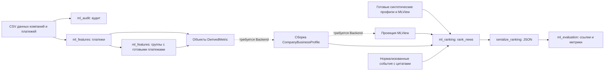

# Передача ML-компонентов Backend

Этот документ — снимок предыдущей интеграционной проверки. Текущее состояние публичных импортов, завершённого breakdown и приёмки находится в [ML_BACKEND_HANDOFF_FINAL.md](ML_BACKEND_HANDOFF_FINAL.md).

Состояние проверяемого workspace на 25.10.2026. Документ описывает существующие Python-функции и выявленные зависимости. Это рабочий документ передачи, а не утверждённый HTTP API или новый контракт EventCandidate. Существующие JSON Schemas не изменяются.

## 1. Граница готовности

Локально доступны две рабочие части цепочки:

1. CSV → аудит → платёжные признаки → групповые признаки с повторным использованием платежей → объекты существующего DerivedMetric.
2. Готовые согласованные CompanyBusinessProfile и MLView → нормализованные новости → ранжирование → JSON → проверка ссылок → оценка на замороженном наборе.

Между ними отсутствует рабочая сборка полного профиля и проекция MLView из реальных признаков. Эти компоненты принадлежат Backend согласно разделам 10.4 и 11.2 BCE draft v0.2. Они не реализованы в рамках этой проверки. `tests/scenarios.py:assemble` формирует ожидаемые синтетические фикстуры; его нельзя считать производственным сборщиком.



Сбор и нормализация реальных новостей, разрешение названий организаций в устойчивые ID, хранение профилей, публичный API и нормализованный Backend-контракт новостей здесь не реализованы. `bce_lab` — отдельный экспериментальный стенд промптов, не рабочий BCE-конвейер.

В `data/raw/` действительно обнаружены три ожидаемых CSV. Наличие файлов не означает наличие построенных реальных профилей. Реальные финансовые показатели не соединялись с синтетическими U_T1/U_T3. В интеграционном тесте расчёты CSV выполняются на отдельном временном синтетическом наборе SMOKE_001, а ранжирование — на неизменённых готовых фикстурах s1/s3/s5.

## 2. Окружение и зависимости

Проверенное окружение: Windows, Python 3.14.0 из `.venv_win`, jsonschema 4.23.0, referencing 0.37.0. `pip check` не обнаружил нарушенных зависимостей. `requirements-dev.txt` содержит jsonschema==4.23.0; referencing устанавливается как его зависимость, но непосредственно используется ранжировщиком. Для исполнения Backend эти библиотеки нужны и вне тестового окружения. Другие версии Python в этом прогоне не проверялись.

| Компонент | Фактические зависимости |
|---|---|
| ml_audit | Стандартная библиотека: csv, Decimal, sqlite3, tempfile, hashlib |
| ml_features | Стандартная библиотека, Fraction, ml_audit.audit и ml_audit.csv_io |
| ml_ranking | jsonschema, referencing, стандартная библиотека, три исходные схемы в schemas/ |
| ml_evaluation | ml_ranking, существующие схемы, стандартная библиотека |
| bce_lab | jsonschema, стандартная библиотека, локальные промпты/схемы/сценарии; сетевой клиент используется только при отдельном live-запуске |

Копирование только каталога ml_features без ml_audit недостаточно. Ранжировщик ищет схемы относительно корня проекта через `__file__`; текущая раскладка должна сохраняться при передаче Backend. Отдельной сборки устанавливаемого пакета и production deployment-конфигурации нет. Демонстрации зависят от tests/fixtures; обычный rank_news принимает объекты вызывающей стороны и не загружает тестовые компании.

## 3. Реализованные функции и форматы

Ниже приведены фактические сигнатуры. `str | Path` обозначает локальный путь, `dict` — Python-объект, соответствующий описанному JSON. Файлы отчётов создаются только функциями записи; вычислительные функции не публикуют профиль или API-ответ.

### Аудит

```python
ml_audit.audit_data(data_dir: str | Path, encoding: str = "auto") -> dict
ml_audit.write_reports(report: dict, output_dir: str | Path) -> tuple[Path, Path]
```

Ищутся df_Uid_data_hack.csv, df_Uid_payment_hack.csv и df_Fid_Uid_link_hack.csv в указанном каталоге и подкаталогах. Неоднозначное обнаружение одного имени отвергается. Разделитель `;`, идентификаторы остаются строками, кодировки определяются по BOM/UTF-8 с резервным CP1251. Аудит возвращает report_version, status, semantics, methodology, datasets и limitations. В datasets находятся размеры, столбцы, пропуски, дубликаты, конфликты и реляционная диагностика.

Минимальные столбцы реляционного анализа: компании — SYNTHETIC_U, GROUP_ID, REVENUE_COMPANY; платежи — PAYER, BENEFICIARY, PAY_AMT, PAY_CNT; физлица — SYNTHETIC_F, SYNTHETIC_U, CITY_NAME, RC_NAME. Остальные присутствующие столбцы тоже исследуются. Отсутствующие файлы/столбцы и ошибки чтения отражаются в отчёте. `status=complete` означает завершённое чтение всех трёх наборов, а не отсутствие проблем качества.

### Платежи и группы

```python
ml_features.compute_payment_features(
    company_id: str, company_csv: str | Path, payment_csv: str | Path,
    *, assume_additive_rows: bool = False, encoding: str = "auto",
) -> PaymentFeatures

ml_features.compute_group_features(
    company_id: str, company_csv: str | Path,
    payment_csv: str | Path | None = None,
    *, payment_features: PaymentFeatures | None = None,
    assume_additive_rows: bool = False, encoding: str = "auto",
) -> GroupFeatures
```

Справочнику нужны SYNTHETIC_U и GROUP_ID; выручка REVENUE_COMPANY используется групповым анализом, но отсутствие этого столбца не запрещает подсчёт состава. Платежам нужны PAYER, BENEFICIARY, PAY_AMT, PAY_CNT. `company_id` — точная строка, без приведения к числу. Непригодные денежные значения исключаются из соответствующих расчётов с явной диагностикой. Дубликаты платежей сохраняются; конфликтующие строки справочника произвольно не разрешаются.

`PaymentFeatures` содержит company_id, metrics, recipients, diagnostics, sources, undefined_reasons, limitations, amount_row_coverage, group_amount_coverage, company_group_id и additive. Суммы и доли внутри вычислений используют Fraction. `GroupFeatures` содержит статус компании, подтверждённую группу, участников, данные о выручке, спорных кандидатов, ссылку на готовые PaymentFeatures, диагностику отношений и манифест источника.

```python
ml_features.serialization.serialize_features(features: PaymentFeatures) -> dict
ml_features.serialization.serialize_derived_metrics(features: PaymentFeatures) -> list[dict]
ml_features.serialization.write_reports(
    features: PaymentFeatures, output_dir: str | Path,
) -> tuple[Path, Path]

ml_features.group_serialization.serialize_group_features(features: GroupFeatures) -> dict
ml_features.group_serialization.serialize_group_derived_metrics(features: GroupFeatures) -> list[dict]
ml_features.group_serialization.write_group_reports(
    features: GroupFeatures, output_dir: str | Path,
) -> tuple[Path, Path]
```

Диагностический JSON и DerivedMetric — разные выходы. В диагностическом JSON деньги записываются точными десятичными строками, доли — числами с дополнительными exact_ratios. Объекты DerivedMetric соответствуют существующему `$defs/DerivedMetric`, но не являются полным профилем.

ML-1A экспортирует шесть имён: counterparty_count_out, top1_counterparty_share_out, top5_counterparty_share_out, hhi_out, intragroup_share_out, counterparty_coverage_in_df_uid. ML-1B экспортирует group_size при подтверждённой группе. Если нет исходящих записей, платёжные DerivedMetric не создаются. Неопределённые метрики могут иметь value=null с ограничениями. Денежные итоги и сумма исходящего PAY_CNT не подставляются в другие имена схемы.

Повторное использование платежей:

```python
payments = compute_payment_features(
    company_id, company_csv, payment_csv, assume_additive_rows=True
)
groups = compute_group_features(
    company_id, company_csv, payment_features=payments
)
```

Одновременно передавать payment_csv и payment_features нельзя. Проверяются company_id, версия справочника по SHA-256, отношения получателей и согласованность агрегатов. Повторного чтения платёжного файла при таком вызове нет. Кэшированный объект относится к зафиксированному хешу платежей; тот же путь к файлу не подтверждает актуальность кэша.

### Ранжирование

```python
ml_ranking.rank_news(
    ml_view: dict, events: Iterable[NewsEvent], *,
    company_profile: dict | None = None,
    analytic_focus: str | None = None, top_k: int = 5,
    as_of: datetime | None = None, urgency_horizon_days: int = 7,
) -> list[RelevanceResult]

ml_ranking.classify_event(
    ml_view: dict, event: NewsEvent, *, company_profile: dict | None = None,
    as_of: datetime | None = None, urgency_horizon_days: int = 7,
) -> RelevanceResult

ml_ranking.serialization.serialize_result(result: RelevanceResult) -> dict
ml_ranking.serialization.serialize_ranking(results: list[RelevanceResult]) -> list[dict]
```

Основной вход — готовый MLView. Полный CompanyBusinessProfile необязателен по сигнатуре, но нужен для проверки оснований компании. Без него отраслевой результат может быть conditional, однако grounded/high и ссылки на несуществующие FACT не создаются. Новые профили, MLView и гипотезы ранжировщик не собирает.

`classify_event` возвращает также none для диагностики. `rank_news` исключает none, ограничивает выдачу top_k и допускает пустой список. top_k — не обязательное количество новостей; 0 допустим. Порядок: grounded перед conditional, подтверждённый близкий срок, специфичность механизма, поддержанный ролью фокус, свежесть, event_id. Числового relevance score или вероятности нет.

### Валидация и доказательства

```python
ml_ranking.validation.validate_contract(value: dict, name: str) -> None
ml_ranking.validation.validate_event(event: NewsEvent) -> None
ml_ranking.validation.company_context(view: dict, profile: dict | None) -> CompanyContext

ml_evaluation.evidence.audit_ranked_evidence(
    result: dict, event: dict, context: dict,
) -> list[str]
```

У validate_contract допустимы имена `view` и `profile`. Это существующие вспомогательные функции Python, а не отдельные утверждённые внешние endpoints. audit_ranked_evidence принимает сериализованный результат, исходную запись события и контекст формата freeze_context; пустой список означает отсутствие обнаруженных проблем ссылок. Проверка не доказывает истинность источника или достаточность юридического толкования.

### Оценка

```python
ml_evaluation.load_dataset(path: str | Path) -> dict
ml_evaluation.validate_dataset(value: dict) -> dict
ml_evaluation.evaluate_dataset(
    dataset: dict, *, split: str = "development", k: int = 5,
    relevant_threshold: int = 1,
) -> dict
ml_evaluation.industry_only_rank(
    ml_view: dict, events: Iterable[NewsEvent], *, top_k: int = 5,
) -> list[str]
ml_evaluation.evaluate_ranking(
    ranking: Sequence[str], judgments: Mapping[str, int | None],
    k: int = 5, relevant_threshold: int = 1,
) -> dict
```

Отдельно доступны dcg(grades), precision_at_k(ranking, judgments, k=5, relevant_threshold=1), recall_at_k с той же сигнатурой и ndcg_at_k(ranking, judgments, k=5). Они возвращают число либо None для неприменимой метрики. Политика знаменателей и N/A описана в [README оценки](../ml_evaluation/README.md).

Для замораживания готовых входов используются `ml_evaluation.dataset.freeze_context(context_id, ml_view, company_profile, provenance)` и `freeze_event(event, event_group_id, split)`. Это упаковка снимков с хешами, не генерация профиля. Набор содержит версии, разбиение по событиям, кандидатные пулы и независимые reviewed/adjudicated оценки. Неполная или спорная разметка не становится нулевой оценкой. Демонстрационный builder загружает только синтетические development-данные; реальная разметка отсутствует.

### Лаборатория BCE

`bce_lab.render.render(sc, schema_mode="prompt", retry_feedback="")` создаёт контекст промпта; `bce_lab.checks.evaluate(ctx, text)` проверяет ответ LLM по схеме, evidence и ограничениям. `bce_lab.runner.dry_run(out_dir, stages=None, models=None, scenarios=None, repeats=None, schema_mode="prompt")` выполняет локальную подготовку и контроли. Это интерфейсы экспериментального стенда, не замена Backend-оркестрации.

В проверке интеграции используется только `python -m bce_lab selftest`: сетевые обращения стенда направлены на локальную имитацию 127.0.0.1. Live-режим и реальные LLM API не запускались.

## 4. Обязательные входы MLView и полного профиля

MLView валидируется по `schemas/profile_views.v1.schema.json#/$defs/MLView` с использованием локального registry трёх исходных схем.

| Поле | Требование |
|---|---|
| schema_version | `1.0.0` |
| company_id, profile_id | Непустые строки, относятся к одному снимку компании |
| as_of_date | ISO-дата версии профиля |
| usability | full, limited, sector_only или unusable |
| weight_semantics | Только ordinal_prior_not_probability |
| hooks | matching_profile, relevance_priors, interpretation_constraints |
| numeric_features | Массив derived_id, name, value, coverage, data_reliability |

matching_profile требует okved_codes, regions, countries, factor_classes_weighted, keywords, negative_keywords. Пустые списки допустимы схемой; отсутствующие обязательные ключи отвергаются. Веса не считаются доказательствами и вероятностями. Numeric value — число или null; coverage — число 0…1 либо null. Неизвестное не заменяется нулём.

У полного профиля обязательны meta, input_quality, facts, derived_metrics, hypotheses, sensitivities, data_conflicts, missing_data, downstream_hooks и provenance. Дополнительно к схемам проверяются совпадение company_id/profile_id/as_of_date, usability и hooks; уникальность ID утверждений; существование и совпадение каждого числового признака MLView с реальной DERIVED-метрикой по ID, имени, значению, покрытию и надёжности; отсутствие повторных ключей breakdown.

Для подтверждения компании нужны provenance.validation.schema_valid и evidence_refs_verified. Это доверенная аттестация Backend. Ранжировщик не сверяет её заново с исходным CSV и не подтверждает сам корректность input_hash, классификатора ОКВЭД или всех ограничений BCE. Backend должен выполнить полную проверку ссылок, значений, конфликтов, missing_data и происхождения до установки этих флагов. Тестовые фикстуры нельзя использовать как источник реальных фактов.

Имеются отдельные проверки состояния исходного поля, конфликтов, data_reliability и FACT. Подтверждение ОКВЭД берётся из input_quality.industry_identification и FACT MAINOKVED_CODE; code_only_unverified не повышается до подтверждённой отрасли. Банковский продукт требует реального FACT действующего клиента; он не доказывает условия договора или потребность в новом кредите. Usability=unusable даёт пустую персонализированную выдачу.

## 5. Связь платёжных признаков с BCE и ранжировщиком

Выход serialize_derived_metrics структурно совместим с существующим DerivedMetric. Чтобы реально использовать его в компании, Backend должен привязать метрики к той же company_id и версии источников, сформировать полный профиль с проверенными FACT/provenance и спроецировать соответствующие числовые признаки в MLView. Простое добавление метрик в фикстуру другой компании недопустимо.

Сейчас serialize_derived_metrics не экспортирует breakdown с ID получателей. Получатели и их доли есть в диагностическом serialize_features, но этот отчёт не является профилем BCE. `CompanyContext.payment_link` требует видимую в MLView DERIVED-метрику с допустимым именем, надёжностью не low, положительным значением/coverage, платежным inputs и положительным breakdown.share для точного ID из новости. Поэтому автоматически получить подтверждённую конкретную связь только из текущего списка DerivedMetric нельзя.

Нужно отдельно согласовать перенос наблюдаемых получателей в breakdown, семантику key, долю, покрытие и ссылку на источник. Поле breakdown уже существует в схеме; этот документ не добавляет его к экспорту и не утверждает новую семантику. Платёжная связь даже после согласованного переноса остаётся conditional и не доказывает поставку.

Group_size, внутригрупповые доли, общие концентрации и выручка сейчас не используются как самостоятельные веса ранжирования. Числовые признаки проверяются на согласованность и могут поддерживать конкретную платёжную связь при наличии необходимого breakdown; они не являются универсальным score. Групповая аналитика, финансовые итоги и LLM-чувствительности не создают автоматически персонализированные механизмы.

Необходимо сохранить подтверждённую семантику: выручка за 2025 год в RUB; 1000 — техническая заглушка. PAY_AMT — RUB, начало периода 1 января, год и конец неизвестны. Аддитивность строк — отдельное явное допущение, по умолчанию False. Неизвестные контрагенты остаются в знаменателях; самоплатежи исключаются из внешней концентрации; общий GROUP_ID не доказывает контроль. Сумма выручки участников не является консолидированной выручкой.

## 6. Ожидаемое внутреннее событие

NewsEvent/ArticleEvidence — существующая внутренняя модель ML-2A. Публичный Backend-контракт новостей не утверждается этим документом. Создание: `NewsEvent.from_dict(value)` преобразует JSON-массивы в tuple, но само по себе не заменяет validate_event; rank_news выполняет проверку повторно.

| Поле | Текущие условия |
|---|---|
| event_id, title, source_id, source_url, event_type | Обязательные непустые строки; URL HTTP(S), не загружается модулем |
| content | Текст либо None; заголовок и метаданные не заменяют доказательство механизма |
| published_at | ISO datetime с часовым поясом либо None |
| factor_classes | Список значений существующего FactorClass |
| okved_codes | Строковые коды; направленное сопоставление области события с кодом компании |
| geography | Список; регистрация компании не подтверждает операционное присутствие |
| entities | Точные устойчивые ID; поиск компании по имени не выполняется |
| evidence | evidence_id, точный quote из content, непустой supports |
| mandatory, applies_to_all_in_scope | bool либо None; флаги проверяются по источнику, не принимаются за факты |
| deadline | ISO-дата либо None; сама дата не подтверждает срочность |
| synthetic | bool; тестовые случаи явно True |

Типы событий: regulation_change, tax_change, input_cost_change, demand_change, monetary_policy_change, counterparty_disruption, other. Список supports ограничен event_type, factor_classes, okved_codes, entities, deadline, mandatory, applies_to_all_in_scope. Цитаты должны буквально присутствовать в переданном content; ID цитат уникальны внутри события. Одинаковые event_id в пуле отвергаются. Разные статьи об одном событии автоматически не объединяются.

Действуют узкие проверки введения/усиления обязанности, отмены, освобождения и неопределённого статуса. Противоречащий mandatory не создаёт high. Освобождение сохраняет объяснимый механизм снижения нагрузки; с подтверждённым основанием компании возможен grounded/normal. Подробности в [описании исправления](../ml_ranking/SEMANTIC_HOTFIX.md). Полное понимание юридического текста и подлинность источника этими правилами не доказываются.

## 7. Выход и доказательства

`serialize_ranking` возвращает JSON-совместимый список. У каждого элемента: rank, event_id, company_id, profile_id, title, source_id, source_url, published_at, synthetic, relevance, priority, relevance_explanation, impact_mechanism, conditions, evidence, limitations, interpretation_constraints, ranking_factors. Rank — порядковая позиция с 1; relevance — grounded/conditional; priority — high/normal/low. None доступен через classify_event и исключён из ranked-выдачи.

Evidence содержит article_quote с исходными evidence_id/quote/source; company_statement с реальным statement_id, company_id/profile_id, epistemic_status, inputs и caveats; либо ссылку ml_view_field с путём и отметкой отсутствия отдельного подтверждения. HYPOTHESIS не становится FACT. Ссылки на компанию должны разрешаться в той же версии профиля, ссылки на статью — в том же событии. Для внешней передачи коротких F-/D-ID недостаточно без company_id и profile_id.

Conditions и limitations должны сохраняться при передаче интерпретатору. Interpretation_constraints передаются из MLView дословно; произвольные новые ограничения в свободном тексте автоматически не интерпретируются. Ranking_factors — техническая диагностика, включая проверенную срочность, специфичность, роль и regulatory_semantics; это не числовая уверенность и не финальный публичный API.

## 8. Роли и время анализа

Analytic_focus принимает None, CFO или CEO с указанным регистром. CFO выделяет поддержанный финансовый механизм; CEO — операционный или стратегический. Фокус применяется только при достаточном подтверждённом основании и не меняет факты, цитаты, релевантность или приоритет. Различие выдач между ролями не гарантируется и не создаётся искусственно.

As_of — aware datetime либо None. Воспроизводимый интеграционный вызов должен передавать его явно. Системное текущее время не подставляется. Будущая публикация относительно as_of отвергается. Дополнительно rank_news и classify_event теперь отвергают MLView.as_of_date позже локальной календарной даты as_of; это согласует их с уже существовавшей проверкой ML-3A.

Найденный дефект до исправления: валидные по схемам s1-профиль и MLView с обеими датами 2026-10-30 принимались при as_of=2026-10-25T12:00:00+03:00 и давали grounded/high. После минимальной проверки вход отвергается ValueError. Сигнатуры и схемы не менялись. Новая проверка покрыта вызовами обеих публичных функций с полным профилем и без него.

MLView содержит дату, а не точное время создания: защита не доказывает отсутствие внутридневной утечки. TTL, устаревание профиля, доступность источника и политика часового пояса должны контролироваться Backend. Без as_of ни будущая дата относительно момента анализа, ни близость срока не подтверждаются; high не создаётся.

## 9. Ошибки и обработка на стороне Backend

| Ситуация | Текущее поведение |
|---|---|
| Нарушение MLView/профиля, расходящиеся версии/значения | ValueError; согласованность проверяется до ранжирования |
| Неверный тип объекта/параметра | TypeError или ValueError в зависимости от проверки |
| Отсутствуют обязательные аргументы NewsEvent.from_dict | TypeError конструктора; единая внешняя оболочка ошибки не задана |
| Неизвестные поля события, класс фактора, тип события, неверная цитата/дата/URL | Ошибка проверки, не пустая успешная выдача |
| Повторные event_id | ValueError, произвольная версия не выбирается |
| Событие или профиль из будущего относительно явного as_of | ValueError |
| Недостаточное основание или отсутствие релевантных событий | conditional либо нормальная пустая выдача [] |
| Ошибка локального файла/кодировки/CSV | OSError, UnicodeError, csv.Error или ValueError; ML-0 часть ошибок сохраняет внутри статусов отчёта |
| Неразрешённая разметка оценки | Метрики запроса N/A, в JSON null |

Один некорректный кандидат останавливает rank_news для всего вызова. Обёртка Backend должна отдельно определить карантин ошибочных новостей, логирование и внешние коды ошибок. Возвращать [] при любой ошибке вместо различения ошибки и корректного пустого результата нельзя. Этот документ не назначает HTTP-коды и не создаёт endpoint.

## 10. Пример вызова на существующих синтетических данных

Код запускается из корня репозитория. Он читает готовый профиль и не собирает его из платёжных признаков.

```python
import json
from datetime import datetime
from pathlib import Path

from ml_evaluation.dataset import freeze_context
from ml_evaluation.evidence import audit_ranked_evidence
from ml_ranking import NewsEvent, rank_news
from ml_ranking.serialization import serialize_ranking
from ml_ranking.validation import validate_contract

base = Path("tests/fixtures/scenarios")
view = json.loads((base / "s1_MLView.json").read_text(encoding="utf-8"))
profile = json.loads(
    (base / "s1_expected_profile.json").read_text(encoding="utf-8")
)
records = json.loads(
    Path("ml_ranking/examples/synthetic_events.json").read_text(encoding="utf-8")
)
record = next(item for item in records if item["event_id"] == "SYN_STEEL_REG")
validate_contract(view, "view")
payload = serialize_ranking(rank_news(
    view, [NewsEvent.from_dict(record)], company_profile=profile,
    analytic_focus="CFO", top_k=1,
    as_of=datetime.fromisoformat("2026-10-25T12:00:00+03:00"),
))
context = freeze_context("HANDOFF_S1", view, profile, "Synthetic fixture s1")
assert audit_ranked_evidence(payload[0], record, context) == []
print(json.dumps(payload, ensure_ascii=False, allow_nan=False, indent=2))
```

Фактический полный JSON-ответ этого вызова приведён в конце документа. Пример синтетический: example.invalid не является реальным источником новости. Для общего пула из восьми существующих событий s1 возвращает четыре результата, s3 — два условных результата; одна и та же металлургическая новость не становится релевантной ИТ-компании.

## 11. Таксономия и неутверждённый EventCandidate

FactorClass берётся из common.v1.schema.json: macro, monetary_policy, fx, commodity_price, industry_demand, industry_regulation, sanctions_trade, tax_fiscal, labor_market, logistics, counterparty_credit, competition, technology. Ранжировщик поддерживает только перечисленные выше типы и механизмы; наличие класса в enum не означает реализованную обработку любого события этого класса.

`bce_lab/data/factor_catalog.json` и kb_stub.json — тестовые заглушки, не утверждённая экспертная база. BCE-схемы ограничивают формат slug, но содержательное соответствие factor ↔ factor_class требует версионированного каталога. Его полноту, владельца, версию классификатора ОКВЭД и правила нормализации новостей должны согласовать Business, Backend и Prompt Engineering.

В просмотренном workspace не найден утверждённый EventCandidate, его схема или более новая спецификация v2.3. Проверить совместимость с отсутствующим документом невозможно. Предлагается обсудить следующее сопоставление; названия целевых полей намеренно не фиксируются:

| Текущий результат ML | Предлагаемое назначение в будущем EventCandidate | Открытый вопрос |
|---|---|---|
| event_id | Идентичность нормализованного события | Событие или публикация, группировка связанных статей, версии |
| company_id, profile_id | Контекст персонализации | Где хранится версия профиля и дата анализа |
| source_id, source_url, published_at | Происхождение новости | Статья с несколькими источниками, обновления, неизвестная дата |
| relevance, priority | Раздельные категории связи и срочности | Согласование enum и смысла с Backend |
| rank | Позиция выдачи | Не переименовывать в вероятность или финансовую значимость |
| impact_mechanism, relevance_explanation | Объяснение ранжировщика | Отличие от финального текста интерпретатора |
| evidence | Типизированные ссылки на статью и профиль | Пространства ID, разрешение ссылок, хранение цитат |
| conditions, limitations, interpretation_constraints | Условия и ограничения | Какие поля обязательны у публичного потребителя |
| ranking_factors, regulatory_semantics | Диагностика проверки | Что хранить внутри Backend, что публиковать |
| synthetic | Маркировка тестового происхождения | Политика исключения тестовых данных из реальной выдачи |

Ни DTO, ни API-адаптер, ни новая JSON Schema в этой проверке не создаются.

## 12. Дублирование, целостность и блокеры

| Наблюдение | Значение для интеграции |
|---|---|
| Парсинг чисел, пропусков, кодировок и CompanyAudit переиспользуются ML-1 из ML-0 | Копировать реализацию для Backend не требуется; зависимость ml_features → ml_audit должна сохраняться |
| В ML-0 и ML-1 есть разные подсчёты дубликатов | Разная область: аудит всех наборов и расчёт выбранного плательщика; нельзя считать их двумя чистящими проходами |
| В bce_lab и ml_ranking есть проверки схем | Они проверяют разные контракты: ответ LLM против профиля/MLView; лабораторный evaluate не заменяет общий валидатор Backend |
| Разные сериализаторы/CLI пишут JSON и Markdown | Общая механика, но разные форматы; объединение не требуется для текущей передачи |
| Каждый новый company_id в ML-1 снова читает CSV и справочник | Пакетный расчёт и его производительность на полном портфеле пока не реализованы |
| Полный профиль и MLView должны совпадать точно | Независимое формирование hooks или округление числовых значений может приводить к отказу; нужна единая проекция Backend |
| Provenance-флаги доверенные, raw CSV не перепроверяется rank_news | Нельзя устанавливать evidence_refs_verified только по успешной JSON Schema |
| Метрики денег и диагностические JSON отличаются от BCE DerivedMetric | Нельзя напрямую передавать serialize_features вместо MLView или произвольно конвертировать null/строки/суммы |

Блокеры реального сквозного запуска:

| ID | Блокер | Необходимый результат и владелец |
|---|---|---|
| B1 | Нет рабочего сборщика профиля и проекции MLView | Backend: один реальный согласованный снимок с проверенными FACT, DERIVED, provenance и ссылками на источники |
| B2 | Не согласована передача конкретных платёжных связей в breakdown | Backend + ML: точный перенос существующих получателей и долей с происхождением; никаких придуманных контрагентов |
| B3 | Нет утверждённого контракта нормализованных новостей/EventCandidate | Backend + Prompt Engineering + ML: поля, идентичность, доказательства, версии, ошибки и отображение результата |
| B4 | Нет реального новостного потока с нормализацией и разрешением ID | Владелец новостного конвейера + Backend: реальные тексты, даты, цитаты и согласованные классификаторы |
| B5 | Каталог факторов/ОКВЭД и реальная разметка не подтверждены | Business + Prompt Engineering: версии каталогов и независимые reviewed/adjudicated оценки |
| B6 | Нет испытанного deployment-пакета и портфельной оркестрации | Backend + ML: доставка схем и зависимостей, политика времени/TTL/кэша, обработка ошибок и масштабирование |

Текущие smoke-тесты подтверждают локальную совместимость доступных частей. Они не подтверждают production readiness или готовность цепочки «реальные CSV → реальный профиль → реальная персональная новость».

## 13. Воспроизведение проверки

```powershell
.\.venv_win\Scripts\python.exe -B -X utf8 -m unittest discover -s tests -p "test_ml_integration_smoke.py" -v
.\.venv_win\Scripts\python.exe -B -X utf8 -m unittest discover -s tests -p "test_*.py"
.\.venv_win\Scripts\python.exe -B -X utf8 -m pip check
```

Smoke использует настоящие функции проверки, rank_news, serialize_ranking, audit_ranked_evidence, расчёты ML-0/ML-1 и evaluate_dataset. Новые news_safety_cases.json — явно синтетические входы для проверки освобождения, отсутствия текста и противоречивых фрагментов. Они не являются новыми оценками качества и не добавлены в набор ML-3A.

`tests/validate_all.py` пересоздаёт фикстуры, `bce_lab selftest` создаёт результаты и использует локальную имитацию. Поэтому эти две команды выполнялись в отдельной временной копии исходных каталогов, без приватных lab.config.json/tariffs.json и без BCE_LLM_API_KEY. Оригинальные данные и фикстуры должны сравниваться по хешам после проверки.

Фактические результаты этого прогона:

| Проверка | Результат |
|---|---|
| Новые интеграционные smoke-тесты | 10/10 |
| Полная модульная регрессия ML-0, ML-1A, ML-1B, ML-2A, ML-3A и hotfix | 220/220, включая 10 новых |
| Исходная проверка контрактов во временной копии | 147/147 |
| Самопроверка лаборатории с локальными имитациями во временной копии | 95/95 |
| pip check | Нарушенных зависимостей нет |
| Выполнение примера из раздела 10 | JSON совпал с полным ответом раздела 15 |
| Проверка стиля изменённого Python | Комментариев, docstrings, строк длиннее 79 символов и хвостовых пробелов нет |
| SHA-256 ранее существовавших файлов | Из 169 изменён только ml_ranking/ranking.py для проверки даты; исходные схемы, фикстуры, CSV и отчёты сохранены |

Новых сетевых интеграций и реальных LLM-вызовов в прогоне не было. Проверки синтетические и не измеряют качество на реальных новостях.

## 14. Следующий рекомендуемый этап

Согласовать B1–B3 с Backend, затем поручить Backend сборку и проекцию одного реального профиля по существующим схемам. После его получения отдельным этапом проверить один реальный кейс на новостях с независимой разметкой. Этот документ не запускает реализацию сборщика, обучение, RAG или следующий этап автоматически.

## 15. Фактический ответ синтетического примера

```json
[
  {
    "rank": 1,
    "event_id": "SYN_STEEL_REG",
    "company_id": "U_T1",
    "profile_id": "U_T1-p1",
    "title": "Учебный пример: новый производственный реестр для металлургии",
    "source_id": "SYNTHETIC_EDITORIAL",
    "source_url": "https://example.invalid/synthetic/steel-regulation",
    "published_at": "2026-10-23T10:00:00+03:00",
    "synthetic": true,
    "relevance": "grounded",
    "priority": "high",
    "relevance_explanation": "ОКВЭД 24.10 подтверждён FACT профиля; связный фрагмент статьи подтверждает обязательное требование для всей указанной отраслевой области.",
    "impact_mechanism": "Применимое требование может потребовать изменения процессов и подготовки обязательной отчётности.",
    "conditions": [
      "Величина эффекта, фактическое исполнение требования и индивидуальные обстоятельства не установлены."
    ],
    "evidence": [
      {
        "kind": "article_quote",
        "event_id": "SYN_STEEL_REG",
        "evidence_id": "QUOTE_STEEL_REG",
        "quote": "Все организации с ОКВЭД 24.10 обязаны до 2026-10-28 подать сведения в новый производственный реестр.",
        "supports": [
          "event_type",
          "factor_classes",
          "okved_codes",
          "mandatory",
          "applies_to_all_in_scope",
          "deadline"
        ],
        "source_id": "SYNTHETIC_EDITORIAL",
        "source_url": "https://example.invalid/synthetic/steel-regulation"
      },
      {
        "kind": "company_statement",
        "statement_id": "F-307d7dbf",
        "company_id": "U_T1",
        "profile_id": "U_T1-p1",
        "epistemic_status": "FACT",
        "data_reliability": "high",
        "inputs": [
          {
            "source": "df_Uid",
            "ref": "MAINOKVED_CODE",
            "value": "24.10",
            "role": "supports"
          }
        ],
        "caveats": [],
        "verified_in_profile": true
      }
    ],
    "limitations": [
      "Размер финансового эффекта и вероятность не оцениваются.",
      "Цитаты проверены по переданному тексту; подлинность источника и корректность внешней классификации отдельно не подтверждаются.",
      "Приоры и ключевые слова не использованы как доказательства.",
      "Новость синтетическая и используется для проверки правил.",
      "Проверены узкие текстовые конструкции; это не полное понимание русского языка и не юридическая экспертиза."
    ],
    "interpretation_constraints": [
      {
        "id": "IC-BANK-FLAG-SCOPE",
        "text": "Значение 0 у CL_PRODUCT_* означает отсутствие продукта только в этом банке; не выводить отсутствие долга, лизинга или гарантий.",
        "origin": "static_rule"
      },
      {
        "id": "IC-ABSENCE-IS-UNKNOWN",
        "text": "Пропущенное значение — это неизвестно, а не отсутствие признака.",
        "origin": "static_rule"
      },
      {
        "id": "IC-NO-INVENTED-ENTITIES",
        "text": "Не называть поставщиков, покупателей, долги, ставки и суммы, которых нет в evidence.",
        "origin": "static_rule"
      }
    ],
    "ranking_factors": {
      "mechanism_specificity": "industry_obligation",
      "impact_domain": "operational",
      "company_basis_verified": true,
      "urgent_deadline_verified": true,
      "verified_deadline": "2026-10-28",
      "days_until_deadline": 3,
      "publication_date_known": true,
      "weight_semantics": "ordinal_prior_not_probability",
      "priors_used_as_evidence": false,
      "regulatory_semantics": {
        "direction": "required",
        "evidence_status": "verified",
        "source_verified": true,
        "scope_verified": true,
        "obligation_verified": true,
        "deadline_verified": true,
        "mandatory_metadata_status": "supported",
        "scope_metadata_status": "supported",
        "supporting_evidence_ids": [
          "QUOTE_STEEL_REG"
        ],
        "limitations": [
          "Проверены узкие текстовые конструкции; это не полное понимание русского языка и не юридическая экспертиза."
        ],
        "normalized_claims": {
          "mandatory": true,
          "applies_to_all_in_scope": true,
          "deadline": "2026-10-28"
        }
      },
      "analytic_focus": "CFO",
      "analytic_focus_applied": false
    }
  }
]
```

